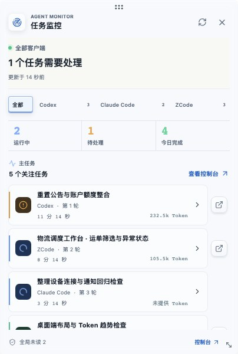
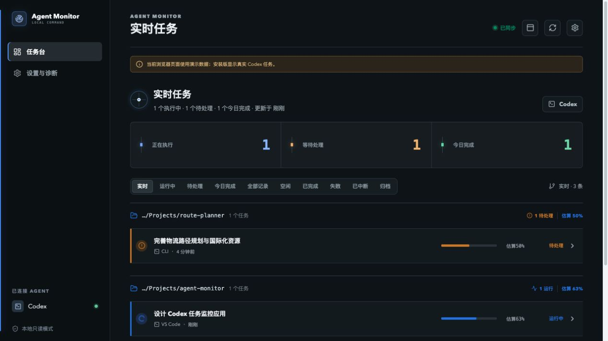

# Agent Monitor

[](https://github.com/lxxaisy/agent-monitor/actions/workflows/ci.yml)
[](LICENSE)
[](https://www.apple.com/macos/)

> A local, read-only macOS companion for Codex, Claude Code and ZCode, with optional AI Passport USB/BLE output.

Agent Monitor keeps active work visible without collecting prompts, answers or command output. It reads supported local client metadata, keeps a bounded local history, and presents one workspace for live tasks, completed work, token usage, account quotas, notifications and connection diagnostics.

## What it does

- Monitors Codex, Claude Code and ZCode from their local metadata and hook surfaces.
- Shows running, needs-action, completed, failed and interrupted work with parent/child relationships.
- Provides a compact menu-bar task radar and a full dashboard with task details.
- Tracks token totals, daily trends, source coverage and six token categories when a client provides them.
- Reads supported account quota windows through the clients' existing local authentication. Credentials are handled in memory for read-only provider requests and are not persisted by Agent Monitor.
- Sends a bounded, read-only snapshot to an AI Passport over USB Serial/JTAG or encrypted BLE. The device can display tasks, alerts, quota windows and settings without approving, cancelling or executing work.
- Keeps desktop notices, Tibo public reset announcements and their source timestamps separate from account state.
- Retains history for 7 days, 30 days, 90 days or 1 year. Cleanup runs automatically and removes only terminal records and their usage; running and needs-action work is retained.
- Includes connection diagnostics, provider health, refresh controls and local snapshot cleanup.

The app is intentionally local-first. It stores task and session metadata, token summaries and deduplication state in its own SQLite database, never prompt or answer bodies, raw JSONL, command output or account secrets. Claude Code's local JSONL is parsed to derive task metadata and usage without retaining message bodies. Quota credentials are read in memory from supported local client stores and sent only to the corresponding provider quota endpoint; Agent Monitor does not persist them.

## Screenshots

The screenshots use synthetic fixture data and are included to show the current UI. They do not contain local tasks, account data or device identifiers.

<p align="center">
  
</p>

<p align="center">
  
</p>

## Install

The repository's source build is the current development path. The public `v0.1.0` DMG is a legacy Codex-only build and does not represent the current multi-client and AI Passport feature set.

Build and run locally on macOS 13 or newer:

```sh
pnpm install
pnpm tauri:dev
```

The app can also be previewed in a browser with `pnpm dev`, but browser preview data is synthetic and cannot read the local clients. A signed, notarized release package has not been published yet.

## Development

Requirements: macOS 13+, Apple Silicon or Intel Mac, Node.js 18+, pnpm, Rust 1.77.2+, and a logged-in supported client when running the native app.

```sh
pnpm install
pnpm typecheck
pnpm build
pnpm test:display
cd src-tauri && cargo test
```

To build an unsigned macOS bundle:

```sh
pnpm tauri:build
```

The generated bundle is under `src-tauri/target/release/bundle/` and is intentionally ignored by Git. The default local database is:

```text
~/Library/Application Support/Agent Monitor/monitor.db
```

## Data boundaries

Agent Monitor starts a local Codex app-server session and reads provider-specific metadata or hook events. Codex sync avoids routine full-turn reads; Claude Code history is parsed locally to derive task status and usage. Message bodies, command output and source JSONL are not persisted. The Activity database stores task identity, project metadata, status, timing, token summaries, source health and notification keys. Terminal history is pruned according to the retention setting.

AI Passport transport is a one-way projection of the local snapshot. USB uses Serial/JTAG; BLE uses the encrypted Nordic UART channel. The device has no command for approval, cancellation, retry or execution. Disconnects retain the last delivered snapshot and its age.

## Related firmware

The ESP32-C3 terminal implementation lives in the personal [`lxxaisy/ai-passport`](https://github.com/lxxaisy/ai-passport) fork of [FoloToy/ai-passport](https://github.com/FoloToy/ai-passport). Its current terminal documentation is in [`docs/agent-monitor-terminal.md`](https://github.com/lxxaisy/ai-passport/blob/main/docs/agent-monitor-terminal.md).

## 中文说明

Agent Monitor 是一个本地只读的 macOS Agent 监控器，当前支持 Codex、Claude Code 和 ZCode，可通过 USB Serial/JTAG 或加密 BLE 将有限快照发送到 AI Passport。

- 任务雷达和完整控制台显示运行中、待处理、已完成、失败、中断任务及父子关系。
- Token 用量页提供总量、每日趋势、来源覆盖率和可用的六类 Token 明细。
- 账户额度通过客户端已有的本机认证查询；凭据仅在内存中用于只读额度请求，Agent Monitor 不会持久化凭据。
- 设置中的历史保留时长支持 7 天、30 天、90 天和 1 年，定期清理已结束记录及其用量，运行中和待处理任务不会被清理。
- AI Passport 仅接收只读状态快照，不能审批、取消、重试或执行任务。
- 应用保留任务、会话、项目路径等轻量元数据、Token 汇总和通知去重键，不保存提示词正文、回答正文、命令输出或原始 JSONL。Claude Code 本机 JSONL 会在本地解析以提取状态与用量，不保留消息正文。额度凭据仅在内存中用于请求对应账户额度，不会被应用持久化。

当前源码构建是最新功能入口；公开的 `v0.1.0` DMG 仍是旧版 Codex-only 构建，尚未代表多客户端和 AI Passport 功能。相关 ESP32-C3 固件位于 [`lxxaisy/ai-passport`](https://github.com/lxxaisy/ai-passport)。

## Uninstall

Quit Agent Monitor from the menu-bar icon, then remove the app. To remove only Agent Monitor's local metadata, delete `~/Library/Application Support/Agent Monitor/`; this does not modify any Codex, Claude Code or ZCode data.

## License

MIT License. See [LICENSE](LICENSE).
